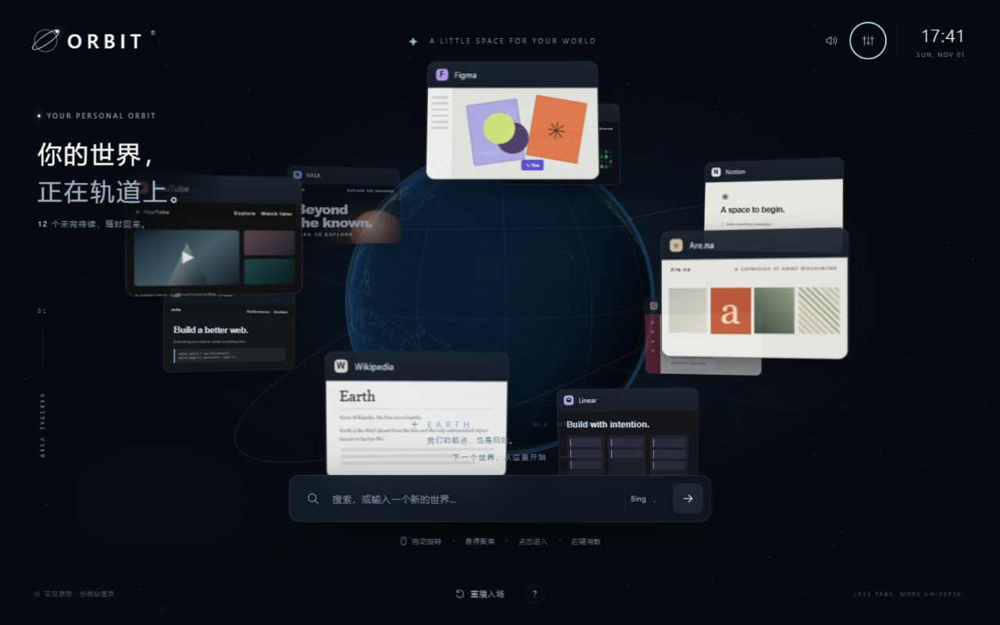

# ORBIT · Tabs around the Earth

**Assignment 3 — an interactive spatial new-tab prototype.**

把未完成的网页变成围绕星球运行的小世界。通过悬停、滚轮、拖拽和点击，整理标签页并进入它们。



## 直接使用

**无需安装：** 下载本仓库（Code → Download ZIP），解压后用 Edge 或 Chrome 打开根目录的 **index.html**。这是约 3.43 MB 的完整单文件网页，包含脚本、样式、Three.js、地球纹理和海岸线；运行原型不需要联网或安装依赖。打开真实网站、使用真实搜索结果时需要网络。

- [公开演示网页](https://lirenji2025.github.io/Tabs-around-the-earth/)
- [GitHub 仓库](https://github.com/Lirenji2025/Tabs-around-the-earth)
- [Sites 原型](https://orbital-earth-tabs.tealglass1.chatgpt.site/)：保留原有访问权限；评阅者可下载单文件使用。
- 源代码入口为 `dist/orbit.js`；根目录 `index.html` 是从源码生成的可分发版本。

## 先试三个动作

1. 悬停一张卡片，点击进入；点击 **返回轨道** 或按 **Esc** 返回。
2. 在星球附近空白处向上滚动，将卡片排成静止横列；向下滚动恢复轨道。
3. 把一张卡片拖到另一张上停留 **0.5 秒**，组成圆形星群；点击星群展开，点击空白收起。

## 操作说明

| 输入 | 响应与反馈 |
| --- | --- |
| 拖动星球附近空白处 | 旋转星球及标签轨道 |
| 悬停卡片 | 放大高亮，其他卡片变暗、减速，播放轻微铜管音 |
| 高亮时滚动 | 缩放至 25%–180%；在边界继续滚动会回弹 |
| 点击卡片 | 镜头进入本地示例页面；可通过明确链接打开真实网站 |
| 拖到其他卡片/星群，停留半秒 | 进度环 → 电磁吸附声 → 圆形星群 |
| 拖到搜索框旁收藏夹，停留半秒 | 收藏夹闪动、进度环及成功提示；原卡片保留 |
| 右键 | 分组、收藏、置顶、移出组或明确关闭；不会立即删除 |
| 置顶 | 淡金色描边；横列右端预留完整位置，多张置顶不重叠 |
| 悬停收藏夹、点击收藏 | 展开列表；生成独立新卡片并进入 |
| 搜索关键词或 HTTP(S) 网址 | 卡片从搜索框分裂，汇入轨道并进入示例结果页 |
| 关闭 / 撤销 / Ctrl或Cmd+Z | 云雾消散；可恢复最近关闭的卡片或星群 |
| 移动鼠标 | 星座连线：最多 8 节点、约 230px 总路径、850ms 生命周期 |
| 设置 → 选择你的星球 | 水星、金星、地球、火星、木星、土星、天王星、海王星；选择自动保存 |
| 设置 → 默认搜索引擎 | 选择 Bing、Google、百度或 DuckDuckGo，自动保存并同步到搜索栏 |
| 设置 | 声效、公转、减少动态效果、帮助、星群/收藏/置顶管理 |

入场恢复第一版的 **散落远离 → 从远处沿弧线飞回轨道** 动画，可跳过或重播。普通轨道没有中心推力；搜索创建/关闭仍保留短暂排斥反馈。

## 本地开发与检查

只需 Node.js 18+，没有需要安装的 npm 依赖。

```sh
git clone https://github.com/Lirenji2025/Tabs-around-the-earth.git
cd Tabs-around-the-earth
node server.mjs
```

打开 `http://127.0.0.1:4173` 查看模块化源码版本；`/standalone.html` 预览生成的单文件版本。

```sh
node --test tests/model.test.mjs
node --check dist/orbit.js
node scripts/build-standalone.mjs
```

修改 `dist/` 后运行最后一条命令，重新生成根目录 `index.html`。打包器只支持本项目使用的静态命名导入/导出，遇到不支持的语法会报错；不是通用 JavaScript 打包器。

## 文件结构

| 文件 | 用途 |
| --- | --- |
| `index.html` | 可直接打开、可独立分发的完整网页 |
| `dist/index.html`, `style.css`, `v2.css` | 模块化页面和视觉样式 |
| `dist/orbit.js` | 输入、投影、动画、面板与状态协调 |
| `dist/model.js` | 分组、收藏、置顶、布局及状态迁移 |
| `dist/globe.js`, `planets.js` | WebGL 星球与原创行星示意纹理 |
| `dist/audio.js`, `trail.js` | 程序合成声效与短星座尾迹 |
| `dist/assets/` | Three.js、许可证、地球纹理和地图数据 |
| `scripts/build-standalone.mjs` | 无第三方依赖的单文件生成器 |
| `tests/model.test.mjs` | 十项状态与布局测试 |
| `PROCESS.md`, `CREDITS.md` | 过程、真实反馈、AI 使用和素材来源 |

## 范围与限制

- 这是网页交互原型，不是 Edge 扩展。卡片是原创示意预览，不能读取、切换或关闭真实浏览器标签页，也没有实际标签栏位置数据。
- 卡片、星群、收藏、置顶、星球选择和偏好存于当前浏览器 localStorage。文件模式持久化规则依浏览器而异；不能保存时仍可使用当前会话。轨道上限 36 张。
- 声效完全本地合成。首次交互前可能被自动播放策略静音。支持减少动态效果、键盘操作、错误提示和关闭撤销。
- 非地球行星是原创程序绘制的视觉示意，大小统一处理，不是科学比例或真实地表影像。土星带三维星环。
- 无 WebGL 时使用静态星球并保留卡片操作。单文件 HTTP 预览已验证；测试工具禁止加载 file: 地址，因此未把双击文件测试写成已完成。

## 作业过程与来源

见 [PROCESS.md](PROCESS.md)：概念、迭代、试用者反馈、AI 建议取舍与开发验证。见 [CREDITS.md](CREDITS.md)：第三方库、素材与许可。Git 历史保留真实开发提交，没有人为补造时间线。
